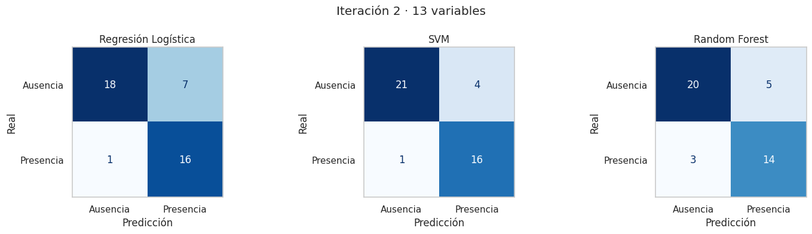
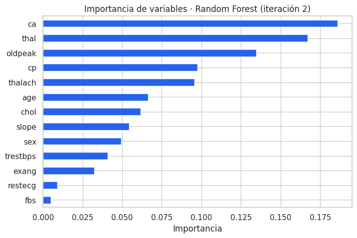

# Predicción de riesgo de enfermedad cardíaca con Machine Learning

Modelo de clasificación que estima si un paciente presenta enfermedad cardíaca a partir de 13 variables clínicas, desarrollado con la metodología **CRISP-DM** en el ramo *Fundamentos de Machine Learning* de **Duoc UC** (2025).

**Equipo:** Diego Arias Zavando · Raúl Olguín Romo
**Docente:** Franco Jorquera P.

---

## Resultado

| | Valor (set de prueba) |
|---|---|
| Modelo seleccionado | SVM lineal dentro de un `Pipeline` con `StandardScaler` |
| **Recall (clase enfermo)** | **94 %**: detecta 16 de 17 pacientes enfermos |
| Precision | 80 % |
| F1-score | 0,865 |
| Accuracy | 88 % |



En un contexto clínico, un **falso negativo** (enfermo clasificado como sano) es más grave que un falso positivo. Por eso el criterio principal fue el **recall** de la clase positiva, equilibrado con el **F1-score**.

## Proceso

1. **Comprensión del negocio.** Las enfermedades cardiovasculares son la principal causa de muerte en Chile (27,5 % de las muertes en 2015, según el MINSAL). El objetivo es apoyar la priorización de pacientes.
2. **Comprensión de los datos.** [Statlog (Heart) Dataset](https://archive.ics.uci.edu/dataset/145/statlog+heart) de UCI: 270 pacientes y 13 variables, con clases balanceadas (56 % sanos, 44 % enfermos).
3. **Preparación.** Exploración con histogramas, correlaciones y boxplots, y eliminación de valores atípicos (quedan 209 registros). División 80/20 estratificada.
4. **Modelado.** Regresión Logística, SVM y Random Forest, optimizados con `GridSearchCV` (validación cruzada estratificada de 5 pliegues, métrica F1).
5. **Evaluación en dos iteraciones:**

| Iteración | Variables | Mejor modelo | Recall | F1 (test) | F1 (CV) |
|---|---|---|---|---|---|
| 1 | 8 (demográficas, signos vitales, laboratorio, ECG en reposo) | Random Forest | 88 % | 0,789 | 0,731 |
| 2 | 13 (se suman dolor torácico, prueba de esfuerzo y fluoroscopía) | SVM lineal | 94 % | 0,865 | 0,817 |

   Volver a la fase de preparación y reincorporar las variables de esfuerzo y fluoroscopía mejoró el modelo. Según el Random Forest, las más influyentes son el número de vasos comprometidos (`ca`), el resultado del test de talio (`thal`) y la depresión del ST (`oldpeak`).

   

6. **Despliegue.** Formulario interactivo con **Gradio** que carga el pipeline guardado con `joblib` y entrega la probabilidad de riesgo.

## Limitaciones

- Con 42 casos de prueba, un solo paciente mueve las métricas varios puntos. Por eso la selección del modelo se apoya en la validación cruzada.
- Eliminar atípicos puede descartar justamente a pacientes de alto riesgo. Una siguiente iteración debería comparar contra modelos robustos a atípicos.
- Los datos provienen de un único estudio de los años 80. Antes de cualquier uso real habría que validar con datos locales.

> Proyecto académico. **No reemplaza la evaluación de un profesional de la salud.**

## Cómo ejecutarlo

```bash
pip install -r requirements.txt
jupyter notebook prediccion_enfermedad_cardiaca.ipynb
```

También se puede abrir en Google Colab. El notebook lee `data/heart.dat`, o lo descarga desde UCI si no lo encuentra. Para abrir el formulario, en la última celda cambia `LANZAR_INTERFAZ = True`.

## Stack

Python · pandas · NumPy · scikit-learn · Matplotlib · seaborn · Gradio · Jupyter

## Notas de la versión

Esta es una versión revisada de la entrega original para el portafolio:

- Se recodificó el target (`0 = ausencia`, `1 = presencia`). En la versión original, scikit-learn tomaba como clase positiva a los pacientes sanos.
- El escalado ahora se ajusta solo con los datos de entrenamiento, dentro de un `Pipeline`, y el formulario aplica exactamente el mismo preprocesamiento.
- Se agregó la segunda iteración con las 13 variables.

## Datos

Statlog (Heart), UCI Machine Learning Repository. Licencia [CC BY 4.0](https://creativecommons.org/licenses/by/4.0/).
